# Especificación de Casos de Uso (CU)
## Sistema E-Commerce y Gestión Omnicanal "ChocoTi-Digital"
### Metodología: RUP / AUP · Análisis Centrado en la Arquitectura

---

## 1. Diagrama General de Casos de Uso

```mermaid
graph LR
    subgraph Actores
        V["👤 Visitante"]
        CM["🛍️ Cliente Minorista"]
        CC["🏛️ Cliente Corporativo"]
        OA["🏭 Operador de Almacén"]
        PREP["📋 Preparador de Pedidos"]
        EMP["📦 Empacador"]
        DESP["🚚 Despachador / Entrega"]
        ADM["👑 Administrador"]
        EXT["🔌 Pasarelas / Adaptadores"]
    end

    subgraph "Módulo de Seguridad y Usuarios"
        CU01["CU-01: Iniciar Sesión"]
        CU02["CU-02: Registrarse (Minorista/Corp)"]
        CU03["CU-03: Administrar Usuarios y Roles"]
    end

    subgraph "Módulo de Catálogo y Favoritos"
        CU04["CU-04: Explorar y Buscar Catálogo"]
        CU05["CU-05: Gestionar Lista de Deseos"]
    end

    subgraph "Módulo de Ventas y Pagos"
        CU06["CU-06: Tramitar Pedido y Reservar Stock"]
        CU07["CU-07: Pagar mediante QR Simulado"]
        CU08["CU-08: Pagar por Transferencia Bancaria"]
        CU09["CU-09: Pagar en Efectivo en Agencia"]
        CU16["CU-16: Procesar Pagos (QR / Depósito / PayPal)"]
    end

    subgraph "Módulo de Operaciones de Planta y Almacén"
        CU10["CU-10: Controlar Stock y Lotes"]
        CU11["CU-11: Registrar Movimiento en Kardex"]
        CU17["CU-17: Preparar Pedido y Picking FEFO"]
        CU18["CU-18: Empacar Pedido y Control Calidad"]
    end

    subgraph "Módulo de Despacho, Entrega y Cierre"
        CU12["CU-12: Rastrear Envíos por Guía"]
        CU19["CU-19: Despachar y Asignar Courier"]
        CU20["CU-20: Validar Retiro en Agencia"]
        CU21["CU-21: Registrar Entrega con Acta Digital"]
        CU22["CU-22: Cerrar y Finalizar Pedido"]
    end

    subgraph "Módulo B2B y Auditoría"
        CU13["CU-13: Solicitar Cotización B2B"]
        CU14["CU-14: Gestionar Cotizaciones"]
        CU15["CU-15: Consultar Planillas y Comprobantes"]
    end

    %% Relaciones Visitante
    V --> CU01
    V --> CU02
    V --> CU04
    V --> CU05
    V --> CU06
    V --> CU12
    V --> CU13

    %% Relaciones Clientes
    CM --> CU01
    CM --> CU04
    CM --> CU05
    CM --> CU06
    CM --> CU12
    CM --> CU15
    CM --> CU22

    CC --> CU01
    CC --> CU04
    CC --> CU06
    CC --> CU13
    CC --> CU15
    CC --> CU22

    %% Relaciones Operador
    OA --> CU01
    OA --> CU10
    OA --> CU11
    OA --> CU15
    OA --> CU16

    %% Relaciones Nuevos Roles Especializados
    PREP --> CU01
    PREP --> CU17

    EMP --> CU01
    EMP --> CU18

    DESP --> CU01
    DESP --> CU19
    DESP --> CU20
    DESP --> CU21

    %% Relaciones Administrador
    ADM --> CU01
    ADM --> CU03
    ADM --> CU10
    ADM --> CU11
    ADM --> CU14
    ADM --> CU15
    ADM --> CU16
    ADM --> CU17
    ADM --> CU18
    ADM --> CU19
    ADM --> CU20
    ADM --> CU21
    ADM --> CU22

    %% Relaciones Adaptadores
    CU07 -.-> EXT
    CU08 -.-> EXT
    CU16 -.-> EXT
```

---

## 2. Tablas de Especificación de Casos de Uso Principales

### CU-01: Iniciar Sesión en el Sistema
| Elemento | Descripción |
|---|---|
| **Identificador** | **CU-01** |
| **Nombre** | Iniciar Sesión en el Sistema |
| **Actores** | Visitante, Cliente Minorista, Cliente Corporativo, Operador de Almacén, Administrador |
| **Propósito** | Validar la identidad de un usuario mediante credenciales criptográficamente seguras para emitir una sesión autenticada con JWT. |
| **Precondiciones** | La cuenta del usuario debe existir previamente y encontrarse en estado `ACTIVO`. |
| **Flujo Principal** | 1. El usuario accede al modal o pantalla de inicio de sesión. 2. Ingresa su correo electrónico y contraseña. 3. El sistema valida el formato de los datos y consulta el repositorio de usuarios. 4. El sistema verifica el hash de la contraseña utilizando `bcrypt.compare`. 5. Si coincide, genera un token JWT firmado que encapsula: `id`, `email`, `rol_id`, `almacen_id`. 6. Inserta un registro en `logs_acceso` con estado `EXITOSO`. 7. El trigger de la base actualiza la fecha `ultima_conexion` del usuario. 8. El cliente almacena el token y redirige al dashboard según el rol del usuario. |
| **Flujos Alternativos** | **3a. Formato inválido:** Notifica mediante Toast de error. **4a. Credenciales incorrectas:** El sistema incrementa el contador de fallos, registra en `logs_acceso` con estado `FALLIDO` y retorna error genérico: *"Correo o contraseña incorrectos"*, sin revelar si el usuario existe. **4b. Supera 5 intentos fallidos:** La cuenta pasa a estado `BLOQUEADO` o se activa un rate limit estricto de 15 minutos. **4c. Cuenta inactiva:** Informa que la cuenta se encuentra deshabilitada y contacte a soporte. |
| **Postcondiciones** | Sesión abierta con token JWT válido; auditoría registrada en base de datos. |

---

### CU-06: Tramitar Pedido y Reservar Stock (Checkout)
| Elemento | Descripción |
|---|---|
| **Identificador** | **CU-06** |
| **Nombre** | Tramitar Pedido con Reserva Temporal de Stock |
| **Actores** | Visitante (Invitado), Cliente Minorista, Cliente Corporativo |
| **Propósito** | Formalizar la compra de los productos en el carrito, calcular costos de envío, retener stock temporal y seleccionar el método de pago. |
| **Precondiciones** | Carrito con al menos un ítem con inventario disponible en el almacén de despacho. |
| **Flujo Principal** | 1. El cliente pulsa "Pagar" desde el carrito. 2. El sistema pregunta "¿Ya tienes una cuenta?" (Iniciar sesión / Crear cuenta / Continuar como invitado). 3. El cliente completa los datos de entrega (Recoger en Agencia Propia Tipo P o Envío a Domicilio). 4. El cliente selecciona el método de pago (QR, Transferencia Bancaria, o Efectivo en Agencia). 5. El sistema crea el registro de pedido con código único (`PED-XXXX`) y estado `PENDIENTE_PAGO`. 6. El sistema crea las reservas en `reservas_stock` con tiempo de expiración según método: &nbsp;&nbsp;• QR: 15 minutos. &nbsp;&nbsp;• Transferencia: 24 horas. &nbsp;&nbsp;• Efectivo en tienda: 48 horas. 7. Notifica al cliente en pantalla el tiempo de reserva y las instrucciones de pago. 8. Si el pago es confirmado, se ejecuta la deducción definitiva de stock en el kardex y se emite la guía de tracking. |
| **Flujos Alternativos** | **3a. "Recoger en agencia":** Solo permite seleccionar agencias tipo P (Sucre o La Paz). Si se intenta seleccionar un punto aliado o cadena, el sistema lo rechaza. **6a. Expiración de Reserva:** Si el tiempo límite expira sin confirmación, un proceso background o verificación libera las existencias reservadas y cambia el estado del pedido a `EXPIRADO`. **8a. Pago fallido o cancelado:** Se cancela la reserva y el stock regresa inmediatamente al inventario disponible. |
| **Postcondiciones** | Pedido creado con código rastreable, stock reservado o descontado, y notificación generada. |

---

### CU-10: Controlar Stock, Lotes y Kardex Multi-almacén
| Elemento | Descripción |
|---|---|
| **Identificador** | **CU-10** |
| **Nombre** | Control de Stock por Almacén, Lotes y Kardex |
| **Actores** | Operador de Almacén, Administrador |
| **Propósito** | Monitorear en tiempo real las existencias físicas, vencimiento de lotes por política FEFO y registrar movimientos de auditoría (entradas, transferencias, ajustes). |
| **Precondiciones** | Usuario autenticado con rol de Operador (restringido a su almacén) o Administrador (acceso global a los 4 almacenes). |
| **Flujo Principal** | 1. El usuario ingresa a la pestaña de Inventario. 2. El sistema aplica el filtro de almacén asignado por token. 3. Consulta la vista de inventario con saldo actual, stock mínimo y lotes asociados. 4. Resalta con alertas visuales de color los SKUs por debajo del stock mínimo o lotes próximos a vencer (< 30 días). 5. Al registrar un movimiento (ej. ingreso por producción o transferencia interdepartamental), el usuario registra cantidad, lote, fecha de vencimiento y motivo. 6. El sistema actualiza la tabla `inventario` y genera una fila inmutable en `kardex_movimientos`. |
| **Flujos Alternativos** | **5a. Transferencia entre almacenes:** Requiere validación de stock suficiente en el almacén de origen. Se debita en origen y se incrementa en destino registrando el usuario ejecutor. |
| **Postcondiciones** | Kardex y saldos de almacén sincronizados sin discrepancias. |

---

### CU-12: Rastrear Envíos por Guía (Tracking Público)
| Elemento | Descripción |
|---|---|
| **Identificador** | **CU-12** |
| **Nombre** | Rastrear Envíos por Guía en Tiempo Real |
| **Actores** | Visitante, Cliente Minorista, Cliente Corporativo |
| **Propósito** | Consultar de forma pública el estado de entrega y tránsito de un paquete mediante su código de guía oficial. |
| **Precondiciones** | La guía debe haber sido emitida por un pedido confirmado en el sistema. |
| **Flujo Principal** | 1. El usuario navega al bloque de "Rastreo de Pedidos". 2. Introduce el número de guía (ej. `GUIA-SUC-1001`) y presiona "Rastrear". 3. El frontend envía la consulta a `GET /api/envios/tracking/:guia`. 4. El servicio backend busca en la base de datos la guía asociada al pedido. 5. Retorna los estados reales registrados (Preparación, Despachado, En Ruta, Entregado) con fecha y courier simulado. 6. La interfaz renderiza el timeline utilizando `textContent` seguro para prevenir ataques XSS. |
| **Flujos Alternativos** | **4a. Guía no existe:** El sistema responde con HTTP 404 y el frontend despliega: *"Guía no encontrada. Verifique el código ingresado"*, sin inventar información de prueba. |
| **Postcondiciones** | Consulta completada con trazabilidad verídica del pedido. |

---

### CU-16: Procesar Pagos Multicanal (QR Simple / Depósito / PayPal Sandbox)
| Elemento | Descripción |
|---|---|
| **Identificador** | **CU-16** |
| **Nombre** | Procesar Pagos Multicanal con Adaptadores |
| **Actores** | Cliente Minorista, Cliente Corporativo, Operador de Almacén, Administrador, Pasarelas |
| **Propósito** | Gestionar los cobros mediante QR dinámico (con polling y cuenta regresiva de 15 min), comprobante bancario manual o pasarela PayPal en USD (tasa 6.96). |
| **Precondiciones** | Pedido creado en estado `PENDIENTE_PAGO` con registro en `pagos_intentos`. |
| **Flujo Principal** | 1. **QR:** El cliente genera el QR; el frontend consulta vía polling el estado cada 3s. Al confirmar, el backend transiciona el pedido a `PAGADO`. 2. **Depósito:** El cliente adjunta comprobante (máx 2MB), banco y número de operación. El Operador de Almacén o Admin revisa en bandeja y aprueba el pago. 3. **PayPal:** El cliente aprueba en PayPal Sandbox en USD; el backend captura la orden v2 y marca el pedido como `PAGADO`. 4. Se inserta registro inmutable en `pedido_historial_estados`. |
| **Flujos Alternativos** | **1a. Vencimiento QR (15 min):** Transiciona a `VENCIDO` / `EXPIRADO` y libera reservas de stock. **2a. Rechazo de comprobante bancario:** Operador ingresa motivo de rechazo; pedido queda en `RECHAZADO` o `CANCELADO`. |
| **Postcondiciones** | Pedido marcado como `PAGADO`, fondos acreditados o comprobados, y reservas consolidadas. |

---

### CU-17: Preparar Pedido y Picking FEFO
| Elemento | Descripción |
|---|---|
| **Identificador** | **CU-17** |
| **Nombre** | Preparación de Pedido y Selección de Lotes FEFO |
| **Actores** | Preparador de Pedidos (`PREPARADOR_PEDIDOS`), Administrador |
| **Propósito** | Recolectar físicamente en estantería los productos de un pedido pagado priorizando lotes con vencimiento más próximo (FEFO) y validar el checklist de picking. |
| **Precondiciones** | Pedido en estado `PAGADO` asignado al almacén del preparador. |
| **Flujo Principal** | 1. El Preparador ingresa a su panel y visualiza los pedidos pagados de su almacén. 2. Selecciona un pedido y presiona "Iniciar Preparación" (transición a `EN_PREPARACION`). 3. El sistema muestra la lista de SKUs con sugerencias de lotes según política FEFO. 4. El preparador valida cada SKU y lote recolectado en el checklist digital. 5. Al completar todos los ítems, presiona "Finalizar Picking" y transiciona a `PREPARADO`. 6. El registro se guarda en `pedido_preparacion` y `pedido_historial_estados`. |
| **Flujos Alternativos** | **4a. Incidencia de stock físico:** Si falta producto en percha, el preparador marca `incidencia_stock = 1`, describe el motivo y el pedido queda en alerta para supervisión. **5a. Transición no autorizada:** Si el preparador intenta transicionar a `EMPACADO` o `DESPACHADO`, el servidor rechaza con HTTP 403 Forbidden. |
| **Postcondiciones** | Pedido en estado `PREPARADO` listo para pasar al área de empaque. |

---

### CU-18: Empacar Pedido y Control de Calidad Térmico
| Elemento | Descripción |
|---|---|
| **Identificador** | **CU-18** |
| **Nombre** | Control de Calidad, Empaque Térmico y Rotulado |
| **Actores** | Empacador (`EMPACADOR`), Administrador |
| **Propósito** | Verificar el contenido de los productos preparados, aplicar aislamiento térmico en destinos cálidos o temporadas calurosas, adjuntar tarjetas de felicitación y sellar cajas. |
| **Precondiciones** | Pedido en estado `PREPARADO` en el almacén asignado. |
| **Flujo Principal** | 1. El Empacador abre la orden en su cola de empaque. 2. El sistema valida si el destino requiere empaque térmico (ej. Santa Cruz) y si incluye tarjeta dedicatoria. 3. El empacador verifica la integridad física de las cajas y bombones. 4. Registra el número de bultos/cajas y peso en kilogramos. 5. Imprime la etiqueta de rotulado y completa el checklist. 6. Si el pedido es `ENVIO_DOMICILIO`, transiciona a `LISTO_DESPACHO`; si es `RECOJO_AGENCIA`, transiciona a `LISTO_RECOJO`. |
| **Flujos Alternativos** | **3a. Producto dañado o faltante:** Devuelve el pedido al preparador con observación registrada. **6a. Intento de cambio de estado a DESPACHADO:** Rechazado con HTTP 403 (exclusivo de despachador). |
| **Postcondiciones** | Pedido rotulado, embalado y registrado en `pedido_empaque`. |

---

### CU-19: Despachar a Domicilio y Asignar Courier
| Elemento | Descripción |
|---|---|
| **Identificador** | **CU-19** |
| **Nombre** | Asignación de Transporte y Despacho a Domicilio |
| **Actores** | Despachador (`DESPACHADOR_ENTREGA`), Administrador |
| **Propósito** | Asignar la empresa de transporte o courier interno, emitir el número de guía de seguimiento y poner en tránsito el pedido. |
| **Precondiciones** | Pedido en estado `LISTO_DESPACHO`. |
| **Flujo Principal** | 1. El Despachador visualiza los pedidos listos para despacho. 2. Asigna la empresa de courier y genera/ingresa la guía de transporte (`GUIA-XXX`). 3. Cambia el estado del pedido a `DESPACHADO`. 4. El sistema registra fecha_despacho en `pedido_entregas` y emite notificación al cliente. |
| **Flujos Alternativos** | **2a. Courier externo no disponible:** El despachador reasigna transporte alternativo con registro de novedad. |
| **Postcondiciones** | Pedido en tránsito con guía consultable en el módulo de tracking público. |

---

### CU-20: Validar Retiro Seguro en Agencia con Código Corto
| Elemento | Descripción |
|---|---|
| **Identificador** | **CU-20** |
| **Nombre** | Retiro de Pedido en Agencia Propia mediante Código Único |
| **Actores** | Despachador / Encargado de Agencia, Cliente Minorista, Administrador |
| **Propósito** | Entregar el paquete en ventanilla de la agencia tras validar el código corto de retiro seguro y verificar la identidad del cliente. |
| **Precondiciones** | Pedido en estado `LISTO_RECOJO` en una agencia propia (Tipo P). |
| **Flujo Principal** | 1. El cliente acude a la agencia y presenta su código de retiro (ej. `RET-4819`). 2. El despachador ingresa el código en la pantalla de validación. 3. El sistema comprueba que el código pertenezca al pedido y se encuentre dentro de la `fecha_limite_retiro`. 4. El despachador entrega los chocolates y marca el pedido como `ENTREGADO`. 5. El sistema registra `codigo_retiro_validado = 1` y actualiza la bitácora inmutable. |
| **Flujos Alternativos** | **3a. Código expirado (> 48 horas):** El sistema alerta estado `EXPIRADO` y exige confirmación administrativa. **3b. Código incorrecto:** Alerta de error y rechazo de entrega. |
| **Postcondiciones** | Pedido entregado físicamente con código invalidado de un solo uso. |

---

### CU-21: Registrar Entrega con Acta Digital
| Elemento | Descripción |
|---|---|
| **Identificador** | **CU-21** |
| **Nombre** | Registro de Entrega Final con Acta Digital |
| **Actores** | Despachador (`DESPACHADOR_ENTREGA`), Administrador |
| **Propósito** | Formalizar la recepción efectiva del chocolate en domicilio registrando nombre, CI del receptor y fotografía de respaldo. |
| **Precondiciones** | Pedido en estado `DESPACHADO`. |
| **Flujo Principal** | 1. El despachador o courier entrega el paquete al cliente. 2. Ingresa en el sistema el nombre completo y documento de identidad (CI) de quien recibe. 3. Opcionalmente adjunta fotografía del paquete recibido. 4. El sistema marca el pedido como `ENTREGADO` y registra la marca temporal exacta `fecha_entrega`. |
| **Flujos Alternativos** | **1a. Destinatario ausente:** Registra intento fallido (incrementa `intentos_realizados`). Si alcanza 3 intentos, transiciona a `DEVUELTO`. |
| **Postcondiciones** | Acta digital completada en `pedido_entregas` y pedido en estado `ENTREGADO`. |

---

### CU-22: Confirmar Conformidad y Cierre de Pedido
| Elemento | Descripción |
|---|---|
| **Identificador** | **CU-22** |
| **Nombre** | Cierre Definitivo de Pedidos y Auto-Finalización |
| **Actores** | Cliente Minorista, Cliente Corporativo, Administrador, Sistema (Daemon/Cron) |
| **Propósito** | Cerrar el ciclo de vida de la orden pasando a estado `FINALIZADO` por conformidad expresa del cliente o transcurridos 7 días sin incidencias. |
| **Precondiciones** | Pedido en estado `ENTREGADO`. |
| **Flujo Principal (Cliente)** | 1. El cliente ingresa a su panel de pedidos. 2. Visualiza el pedido entregado y presiona "Confirmar Conformidad". 3. El pedido transiciona a `FINALIZADO` y se registra `fecha_finalizado`. |
| **Flujo Alternativo (Auto-Cierre)** | **1a. Cierre automático por sistema:** Una tarea programada revisa diariamente pedidos entregados hace más de 7 días sin reclamos abiertos. Transiciona a `FINALIZADO` con motivo `AUTO_FINALIZACION_7_DIAS`. |
| **Postcondiciones** | Transacción comercial concluida formalmente sin posibilidad de reversión de estados. |
