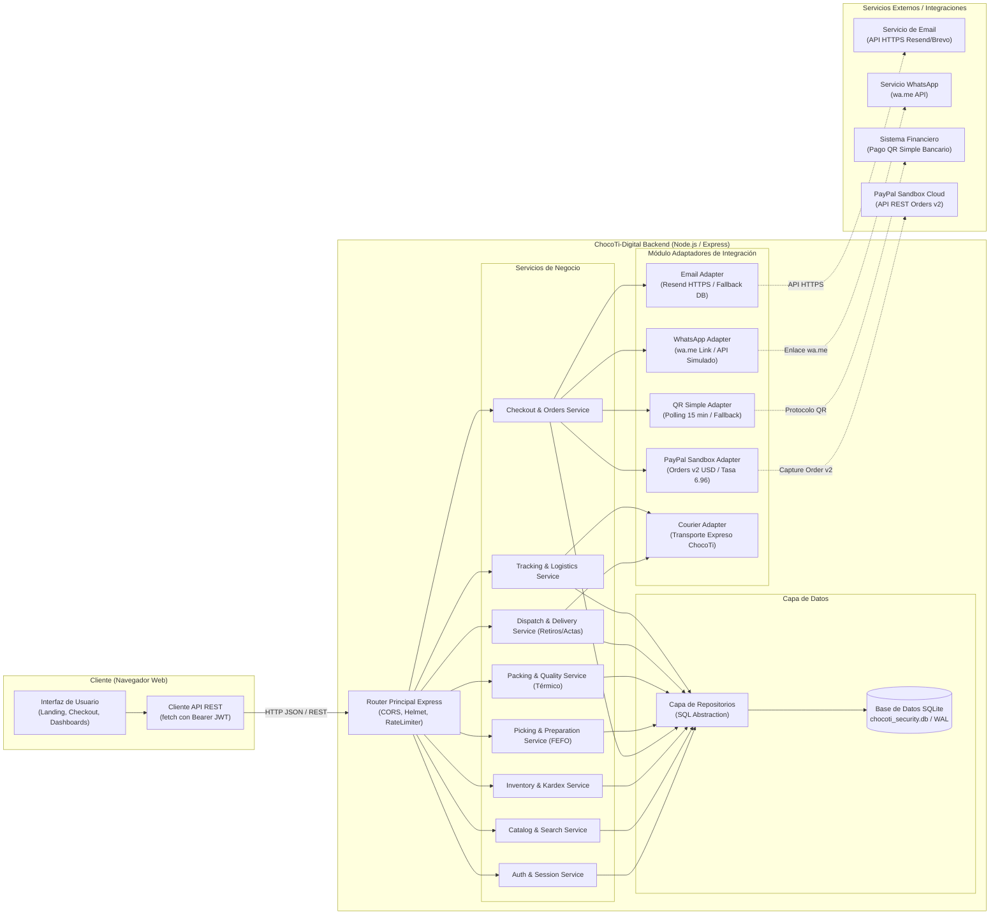
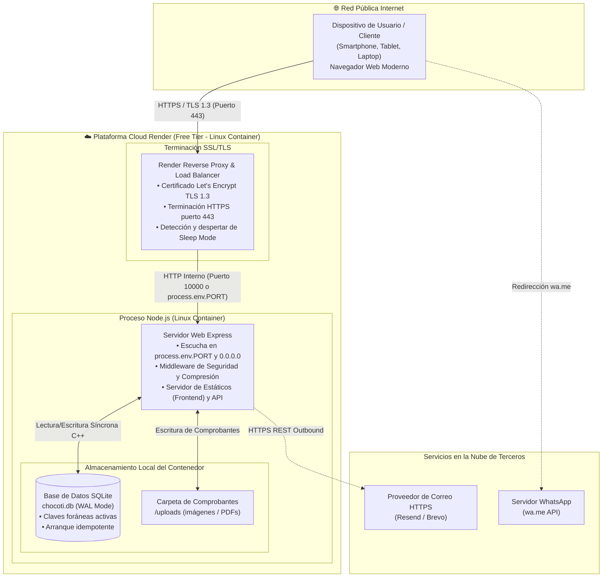
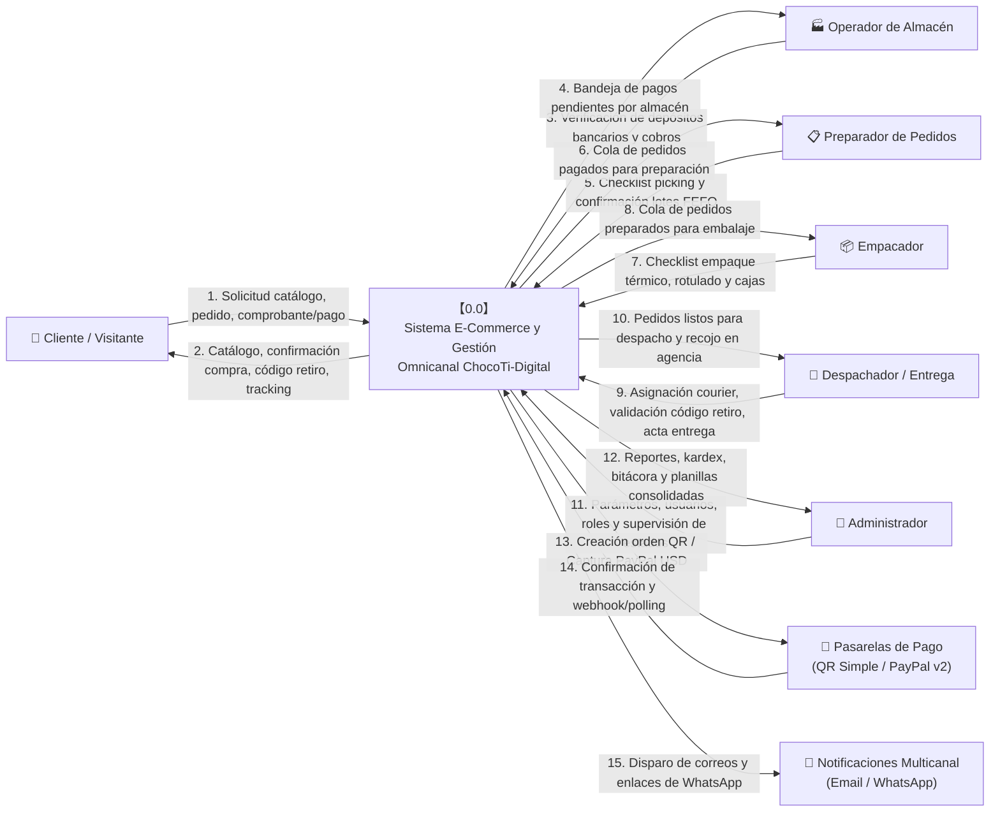
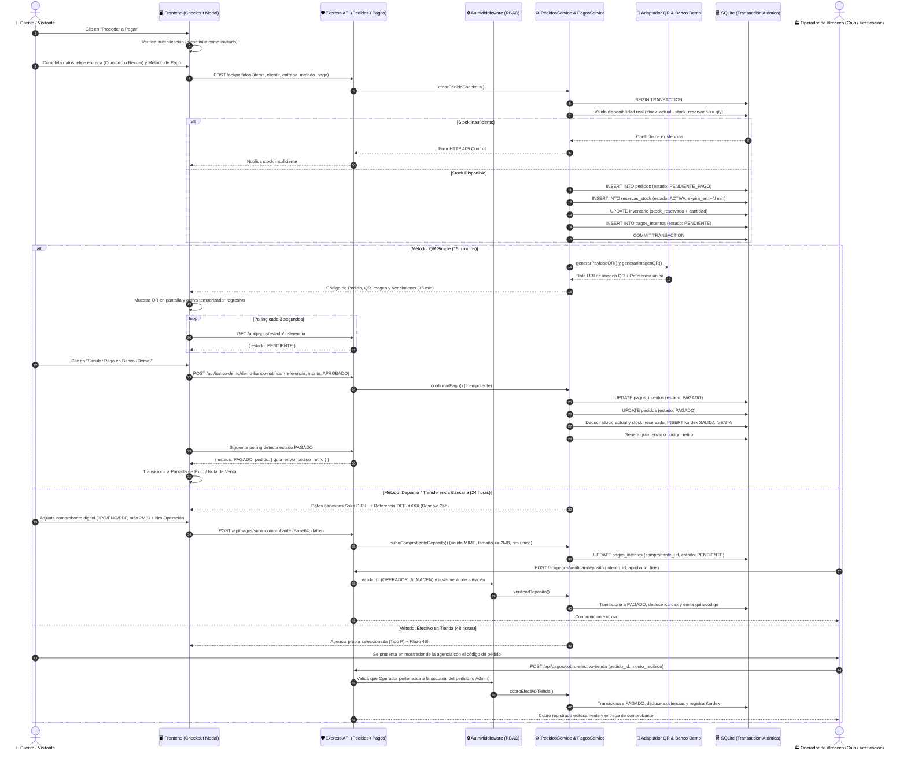

# Diagramas de Arquitectura de Software
## Sistema E-Commerce y Gestión Omnicanal "ChocoTi-Digital"
### Metodología: RUP / AUP · Modelo de Diseño 4+1 Vistas en Mermaid

---

## 1. Diagrama de Paquetes del Sistema (con dependencias `<<uses>>`)

Representa la estructura modular en 3 capas por módulo y las dependencias arquitectónicas estrictas.

```mermaid
flowchart TD
    subgraph "Capa de Presentación (Frontend)"
        P_LAND["pkg_landing<br>(Landing, Catálogo, Carrito)"]
        P_AUTH_UI["pkg_auth_ui<br>(Login, Registro, Perfil)"]
        P_DASH["pkg_dashboards<br>(Admin, Almacén, Clientes)"]
        P_SHARED_UI["pkg_shared_ui<br>(Toasts, API Client, Auth Guard)"]
    end

    subgraph "Capa de Control y Lógica de Negocio (Backend API)"
        subgraph "Middleware y Configuración"
            P_SEC["pkg_seguridad_mw<br>(JWT, RateLimiter, Helmet)"]
            P_CFG["pkg_config<br>(Empresa, Variables Entorno)"]
        end

        subgraph "Módulos de Negocio"
            P_MOD_AUTH["pkg_modulo_auth<br>(Controller, Service)"]
            P_MOD_USERS["pkg_modulo_usuarios<br>(Controller, Service)"]
            P_MOD_PROD["pkg_modulo_catalogo<br>(Controller, Service)"]
            P_MOD_INV["pkg_modulo_inventario<br>(Controller, Service)"]
            P_MOD_VENTAS["pkg_modulo_ventas_checkout<br>(Controller, Service)"]
            P_MOD_PREP["pkg_modulo_preparacion_picking<br>(Controller, Service FEFO)"]
            P_MOD_EMP["pkg_modulo_empaque_control<br>(Controller, Service Térmico)"]
            P_MOD_ENTR["pkg_modulo_entregas_despacho<br>(Controller, Service Retiros)"]
            P_MOD_ENV["pkg_modulo_envios_tracking<br>(Controller, Service)"]
            P_MOD_B2B["pkg_modulo_b2b<br>(Controller, Service)"]
            P_MOD_PV["pkg_modulo_puntos_venta<br>(Controller, Service)"]
        end

        subgraph "Adaptadores de Integración (Patrón Adapter)"
            P_ADAPTERS["pkg_adaptadores<br>(QR Simple, PayPal Orders v2, Courier, Email, WhatsApp)"]
        end
    end

    subgraph "Capa de Persistencia y Acceso a Datos"
        P_REPOS["pkg_repositorios<br>(DAOs / Repositories)"]
        P_DB["pkg_base_datos<br>(SQLite better-sqlite3 / WAL)"]
    end

    %% Relaciones Presentación a Control
    P_LAND ..>|"<<uses>>"| P_SHARED_UI
    P_AUTH_UI ..>|"<<uses>>"| P_SHARED_UI
    P_DASH ..>|"<<uses>>"| P_SHARED_UI
    P_SHARED_UI ..>|"<<uses HTTP REST>>"| P_SEC

    %% Seguridad hacia controladores
    P_SEC ..>|"<<uses>>"| P_MOD_AUTH
    P_SEC ..>|"<<uses>>"| P_MOD_USERS
    P_SEC ..>|"<<uses>>"| P_MOD_PROD
    P_SEC ..>|"<<uses>>"| P_MOD_INV
    P_SEC ..>|"<<uses>>"| P_MOD_VENTAS
    P_SEC ..>|"<<uses>>"| P_MOD_PREP
    P_SEC ..>|"<<uses>>"| P_MOD_EMP
    P_SEC ..>|"<<uses>>"| P_MOD_ENTR
    P_SEC ..>|"<<uses>>"| P_MOD_ENV
    P_SEC ..>|"<<uses>>"| P_MOD_B2B
    P_SEC ..>|"<<uses>>"| P_MOD_PV

    %% Orquestación de servicios entre módulos
    P_MOD_VENTAS ..>|"<<uses>>"| P_MOD_INV
    P_MOD_VENTAS ..>|"<<uses>>"| P_ADAPTERS
    P_MOD_VENTAS ..>|"<<uses>>"| P_MOD_PREP
    P_MOD_PREP ..>|"<<uses>>"| P_MOD_INV
    P_MOD_PREP ..>|"<<uses>>"| P_MOD_EMP
    P_MOD_EMP ..>|"<<uses>>"| P_MOD_ENTR
    P_MOD_ENTR ..>|"<<uses>>"| P_MOD_ENV

    %% Control a Repositorios
    P_MOD_AUTH ..>|"<<uses>>"| P_REPOS
    P_MOD_USERS ..>|"<<uses>>"| P_REPOS
    P_MOD_PROD ..>|"<<uses>>"| P_REPOS
    P_MOD_INV ..>|"<<uses>>"| P_REPOS
    P_MOD_VENTAS ..>|"<<uses>>"| P_REPOS
    P_MOD_PREP ..>|"<<uses>>"| P_REPOS
    P_MOD_EMP ..>|"<<uses>>"| P_REPOS
    P_MOD_ENTR ..>|"<<uses>>"| P_REPOS
    P_MOD_ENV ..>|"<<uses>>"| P_REPOS
    P_MOD_B2B ..>|"<<uses>>"| P_REPOS
    P_MOD_PV ..>|"<<uses>>"| P_REPOS

    %% Repositorios a DB
    P_REPOS ..>|"<<uses>>"| P_DB
```

---

## 2. Diagrama de Clases del Dominio Principal

```mermaid
classDiagram
    class Usuario {
        +int id
        +string nombreCompleto
        +string email
        +string passwordHash
        +string ciNit
        +string telefono
        +string tipoCliente
        +string razonSocial
        +int rolId
        +int almacenId
        +string estado
        +validarPassword(plain) bool
        +esAdmin() bool
        +esOperador() bool
    }

    class Rol {
        +int id
        +string nombre
        +string descripcion
    }

    class Almacen {
        +int id
        +string nombre
        +string ciudad
        +string direccion
        +string tipo
        +bool activo
    }

    class Producto {
        +int id
        +string sku
        +string nombre
        +string descripcion
        +float precio
        +int categoriaId
        +int stockMinimo
        +bool activo
        +verificarDisponibilidad(almacenId) int
    }

    class Inventario {
        +int id
        +int productoId
        +int almacenId
        +int stockActual
        +int stockReservado
        +stockDisponible() int
    }

    class Lote {
        +int id
        +string loteCodigo
        +int productoId
        +int almacenId
        +int cantidad
        +date fechaVencimiento
        +estaVencido() bool
    }

    class KardexMovimiento {
        +int id
        +string tipoMovimiento
        +int productoId
        +int almacenOrigenId
        +int almacenDestinoId
        +int cantidad
        +int usuarioId
        +string motivo
        +datetime fechaHora
    }

    class Pedido {
        +int id
        +string codigoPedido
        +int usuarioId
        +string tipoEntrega
        +int puntoRecojoId
        +string direccionEnvio
        +int almacenId
        +string metodoPago
        +string estadoPago
        +string estadoPedido
        +float subtotal
        +float costoEnvio
        +float total
        +float montoUsd
        +float tipoCambioUsd
        +string codigoRetiro
        +datetime fechaLimiteRetiro
        +datetime fechaFinalizado
        +int diasParaFinalizar
        +string comprobanteUrl
        +string transaccionRef
        +string guiaEnvio
        +string courier
        +transicionarEstado(nuevoEstado, usuarioId, rol)
        +validarCodigoRetiro(codigo) bool
        +autoFinalizar() bool
    }

    class PedidoHistorialEstados {
        +int id
        +int pedidoId
        +string estadoAnterior
        +string estadoNuevo
        +int usuarioId
        +string rolTransicion
        +string motivo
        +string comentario
        +datetime fechaHora
    }

    class PagosIntentos {
        +int id
        +int pedidoId
        +string proveedor
        +string referenciaExterna
        +float montoBob
        +float montoUsd
        +float tipoCambio
        +string estado
        +string datosProveedorJson
        +string comprobanteUrl
        +string bancoOrigen
        +string numeroOperacion
        +int verificadoPorId
        +datetime fechaVerificacion
        +datetime expiraEn
    }

    class PedidoPreparacion {
        +int id
        +int pedidoId
        +int almacenId
        +int preparadorId
        +datetime fechaInicio
        +datetime fechaFin
        +string checklistPickingJson
        +int incidenciaStock
        +string detalleIncidencia
        +string estado
    }

    class PedidoEmpaque {
        +int id
        +int pedidoId
        +int almacenId
        +int empacadorId
        +datetime fechaInicio
        +datetime fechaFin
        +bool empaqueTermico
        +bool tarjetaMensaje
        +string textoTarjeta
        +bool etiquetaGenerada
        +float pesoKg
        +int numeroCajas
        +string checklistEmpaqueJson
        +string estado
    }

    class PedidoEntregas {
        +int id
        +int pedidoId
        +int despachadorId
        +int almacenId
        +string tipoEntrega
        +string courier
        +string guiaTransporte
        +string codigoRetiro
        +bool codigoRetiroValidado
        +string receptorNombre
        +string receptorCi
        +string fotoComprobanteUrl
        +int intentosRealizados
        +int maxIntentos
        +string estadoEntrega
        +datetime fechaDespacho
        +datetime fechaEntrega
    }

    class DetallePedido {
        +int id
        +int pedidoId
        +int productoId
        +int cantidad
        +float precioUnitario
        +float subtotal
    }

    class ReservaStock {
        +int id
        +int pedidoId
        +int productoId
        +int almacenId
        +int cantidad
        +datetime expiraEn
        +string estado
        +haExpirado() bool
    }

    class PuntoVenta {
        +int id
        +string ciudad
        +string tipo
        +string nombre
        +string direccion
        +string telefono
        +bool permiteRecojo
    }

    %% Relaciones de Dominio
    Usuario "1" --> "1" Rol : asignado_a
    Usuario "0..1" --> "1" Almacen : opera_en
    Inventario "0..*" --> "1" Producto : existencia_de
    Inventario "0..*" --> "1" Almacen : ubicado_en
    Lote "0..*" --> "1" Producto : lote_de
    Lote "0..*" --> "1" Almacen : almacenado_en
    KardexMovimiento "0..*" --> "1" Producto : involucra
    KardexMovimiento "0..*" --> "1" Usuario : registrado_por
    Pedido "1" *-- "1..*" DetallePedido : contiene
    Pedido "1" *-- "0..*" ReservaStock : reserva_temporaria
    Pedido "1" *-- "1..*" PedidoHistorialEstados : audita_transicion
    Pedido "1" *-- "1..*" PagosIntentos : registra_pago
    Pedido "1" *-- "0..1" PedidoPreparacion : preparado_en
    Pedido "1" *-- "0..1" PedidoEmpaque : empacado_en
    Pedido "1" *-- "0..1" PedidoEntregas : entregado_en
    Pedido "0..*" --> "0..1" Usuario : realizado_por
    Pedido "0..*" --> "0..1" PuntoVenta : recojo_en
    Pedido "0..*" --> "1" Almacen : despachado_desde
```



---

## 3. Diagrama de Componentes e Integraciones Externas



---

## 4. Diagrama de Despliegue (Nodos y Arquitectura Cloud en Render)



---

## 5. Diagramas de Flujo de Datos (DFD)

### 5.1 DFD Nivel 0 (Diagrama de Contexto)



### 5.2 DFD Nivel 1 (Descomposición Funcional por Procesos)

```mermaid
flowchart TD
    %% Entidades Externas
    CLI["👤 Cliente"]
    ADM["👑 Admin / Operador"]
    PREP["📋 Preparador"]
    EMP["📦 Empacador"]
    DESP["🚚 Despachador"]

    %% Procesos
    P1["1.0 Autenticación y Control de Acceso (RBAC)"]
    P2["2.0 Gestión de Catálogo y Búsqueda"]
    P3["3.0 Gestión de Inventarios y Kardex"]
    P4["4.0 Procesamiento de Checkout y Pagos"]
    P5["5.0 Picking y Preparación FEFO"]
    P6["6.0 Empaque y Control de Calidad Térmico"]
    P7["7.0 Despacho, Retiros en Agencia y Actas de Entrega"]
    P8["8.0 Cotizaciones B2B Corporativas"]
    P9["9.0 Cierre y Auto-finalización de Pedidos"]

    %% Almacenes de Datos (Data Stores)
    D1[("D1: Usuarios y Roles")]
    D2[("D2: Catálogo de Productos")]
    D3[("D3: Inventario, Lotes y Kardex")]
    D4[("D4: Pedidos y Reservas")]
    D5[("D5: Historial y Pagos Intentos")]
    D6[("D6: Preparación, Empaque y Entregas")]
    D7[("D7: Cotizaciones B2B")]
    D8[("D8: Bitácora de Acceso")]

    %% Flujos Proceso 1.0
    CLI -->|"Credenciales"| P1
    ADM -->|"Credenciales"| P1
    PREP -->|"Credenciales"| P1
    EMP -->|"Credenciales"| P1
    DESP -->|"Credenciales"| P1
    P1 <-->|"Verifica credenciales"| D1
    P1 -->|"Registra evento"| D8
    P1 -->|"Token JWT con rol y almacen_id"| CLI
    P1 -->|"Token JWT con rol y almacen_id"| ADM

    %% Flujos Proceso 2.0
    CLI -->|"Filtro de búsqueda"| P2
    P2 <-->|"Consulta productos y categorías"| D2
    P2 <-->|"Calcula Stock Disponible = Físico - Reservas"| D3
    P2 -->|"Productos disponibles"| CLI

    %% Flujos Proceso 3.0
    ADM -->|"Entrada, ajuste o transferencia"| P3
    P3 <-->|"Actualiza saldos y lotes"| D3
    P3 -->|"Alertas stock bajo / vencimiento"| ADM

    %% Flujos Proceso 4.0
    CLI -->|"Confirmación compra (QR/Depósito/PayPal)"| P4
    P4 -->|"Crea pedido en PENDIENTE_PAGO"| D4
    P4 -->|"Reserva temporal de stock"| D3
    P4 -->|"Registra intento pago"| D5
    ADM -->|"Aprueba depósito bancario"| P4
    P4 -->|"Transiciona a PAGADO y deduce Kardex"| D4

    %% Flujos Proceso 5.0
    PREP -->|"Inicia picking y confirma lotes FEFO"| P5
    P5 <-->|"Lee pedido PAGADO de su almacén"| D4
    P5 <-->|"Consulta lotes FEFO"| D3
    P5 -->|"Registra checklist picking"| D6
    P5 -->|"Transiciona a PREPARADO"| D4
    P5 -->|"Audita en historial"| D5

    %% Flujos Proceso 6.0
    EMP -->|"Valida empaque térmico, tarjetas y cajas"| P6
    P6 <-->|"Lee pedido PREPARADO"| D4
    P6 -->|"Registra checklist empaque"| D6
    P6 -->|"Transiciona a LISTO_DESPACHO / LISTO_RECOJO"| D4
    P6 -->|"Audita en historial"| D5

    %% Flujos Proceso 7.0
    DESP -->|"Asigna courier o valida código retiro"| P7
    P7 <-->|"Lee pedido listo"| D4
    P7 -->|"Genera guía y acta con foto/CI"| D6
    P7 -->|"Transiciona a DESPACHADO / ENTREGADO"| D4
    P7 -->|"Audita en historial"| D5
    CLI -->|"Consulta tracking público por guía"| P7

    %% Flujos Proceso 8.0
    CLI -->|"Requerimiento mayorista"| P8
    P8 -->|"Registra cotización"| D7
    ADM <-->|"Revisa y responde cotizaciones"| D7

    %% Flujos Proceso 9.0
    CLI -->|"Confirmar conformidad"| P9
    P9 <-->|"Lee pedido ENTREGADO > 7 días o cliente"| D4
    P9 -->|"Transiciona a FINALIZADO"| D4
    P9 -->|"Audita en historial"| D5
```



---

## 6. Diagrama Entidad-Relación (ERD) Completo

```mermaid
erDiagram
    ROLES ||--o{ USUARIOS : "tienen"
    ALMACENES ||--o{ USUARIOS : "asignan_a"
    USUARIOS ||--o{ LOGS_ACCESO : "generan"
    USUARIOS ||--o{ PEDIDOS : "realizan"
    USUARIOS ||--o{ LISTA_DESEOS : "guardan"
    USUARIOS ||--o{ COTIZACIONES_B2B : "solicitan"
    USUARIOS ||--o{ KARDEX_MOVIMIENTOS : "ejecutan"

    CATEGORIAS ||--o{ PRODUCTOS : "agrupan"
    PRODUCTOS ||--o{ INVENTARIO : "poseen"
    ALMACENES ||--o{ INVENTARIO : "custodian"
    PRODUCTOS ||--o{ LOTES : "clasifican"
    ALMACENES ||--o{ LOTES : "almacenan"
    PRODUCTOS ||--o{ KARDEX_MOVIMIENTOS : "registran"
    PRODUCTOS ||--o{ DETALLE_PEDIDOS : "incluyen"
    PRODUCTOS ||--o{ LISTA_DESEOS : "desean"
    PRODUCTOS ||--o{ RESERVAS_STOCK : "retienen"

    PEDIDOS ||--|{ DETALLE_PEDIDOS : "contiene"
    PEDIDOS ||--o{ RESERVAS_STOCK : "comprometen"
    PEDIDOS ||--o{ NOTIFICACIONES_LOGS : "disparan"
    PEDIDOS ||--o{ PEDIDO_HISTORIAL_ESTADOS : "audita"
    PEDIDOS ||--o{ PAGOS_INTENTOS : "recibe"
    PEDIDOS ||--o| PEDIDO_PREPARACION : "preparado_en"
    PEDIDOS ||--o| PEDIDO_EMPAQUE : "empacado_en"
    PEDIDOS ||--o| PEDIDO_ENTREGAS : "entregado_en"
    PUNTOS_VENTA ||--o{ PEDIDOS : "entregan_en"
    ALMACENES ||--o{ PEDIDOS : "despacha"
    USUARIOS ||--o{ PEDIDO_PREPARACION : "prepara"
    USUARIOS ||--o{ PEDIDO_EMPAQUE : "empaca"
    USUARIOS ||--o{ PEDIDO_ENTREGAS : "distribuye"

    ROLES {
        int id PK
        string nombre UK
        string descripcion
    }

    ALMACENES {
        int id PK
        string nombre
        string ciudad
        string direccion
        string tipo
        int activo
    }

    USUARIOS {
        int id PK
        string nombre_completo
        string email UK
        string password_hash
        string ci_nit
        string telefono
        string tipo_cliente
        string razon_social
        int rol_id FK
        int almacen_id FK
        string estado
        datetime fecha_creacion
        datetime ultima_conexion
    }

    LOGS_ACCESO {
        int id PK
        int usuario_id FK
        datetime fecha_hora
        string ip_origen
        string estado_login
        string detalles
    }

    CATEGORIAS {
        int id PK
        string nombre UK
        string descripcion
        int activo
    }

    PRODUCTOS {
        int id PK
        string sku UK
        string nombre
        string descripcion
        decimal precio
        int categoria_id FK
        string imagen_url
        int stock_minimo
        int activo
    }

    INVENTARIO {
        int id PK
        int producto_id FK
        int almacen_id FK
        int stock_actual
        int stock_reservado
    }

    LOTES {
        int id PK
        string lote_codigo
        int producto_id FK
        int almacen_id FK
        int cantidad
        date fecha_vencimiento
        date fecha_ingreso
    }

    KARDEX_MOVIMIENTOS {
        int id PK
        string tipo_movimiento
        int producto_id FK
        int almacen_origen_id FK
        int almacen_destino_id FK
        int cantidad
        int usuario_id FK
        string motivo
        datetime fecha_hora
    }

    PEDIDOS {
        int id PK
        string codigo_pedido UK
        int usuario_id FK
        string tipo_entrega
        int punto_recojo_id FK
        string direccion_envio
        int almacen_id FK
        string cliente_nombre
        string cliente_ci_nit
        string cliente_telefono
        string cliente_email
        string metodo_pago
        string estado_pago
        string estado_pedido
        decimal subtotal
        decimal costo_envio
        decimal descuento
        decimal total
        decimal monto_usd
        decimal tipo_cambio_usd
        string codigo_retiro UK
        datetime fecha_limite_retiro
        datetime fecha_finalizado
        int dias_para_finalizar
        string comprobante_url
        string transaccion_ref
        string guia_envio UK
        string courier
        text notas
        datetime created_at
        datetime updated_at
    }

    PEDIDO_HISTORIAL_ESTADOS {
        int id PK
        int pedido_id FK
        string estado_anterior
        string estado_nuevo
        int usuario_id FK
        string rol_transicion
        string motivo
        text comentario
        datetime fecha_hora
    }

    PAGOS_INTENTOS {
        int id PK
        int pedido_id FK
        string proveedor
        string referencia_externa
        decimal monto_bob
        decimal monto_usd
        decimal tipo_cambio
        string estado
        text datos_proveedor_json
        string comprobante_url
        string banco_origen
        string numero_operacion
        int verificado_por_id FK
        datetime fecha_verificacion
        datetime expira_en
        datetime created_at
    }

    PEDIDO_PREPARACION {
        int id PK
        int pedido_id FK
        int almacen_id FK
        int preparador_id FK
        datetime fecha_inicio
        datetime fecha_fin
        text checklist_picking_json
        int incidencia_stock
        text detalle_incidencia
        string estado
        text notas
    }

    PEDIDO_EMPAQUE {
        int id PK
        int pedido_id FK
        int almacen_id FK
        int empacador_id FK
        datetime fecha_inicio
        datetime fecha_fin
        int empaque_termico
        int tarjeta_mensaje
        text texto_tarjeta
        int etiqueta_generada
        decimal peso_kg
        int numero_cajas
        text checklist_empaque_json
        string estado
        text notas
    }

    PEDIDO_ENTREGAS {
        int id PK
        int pedido_id FK
        int despachador_id FK
        int almacen_id FK
        string tipo_entrega
        string courier
        string guia_transporte
        string codigo_retiro
        int codigo_retiro_validado
        string receptor_nombre
        string receptor_ci
        string foto_comprobante_url
        int intentos_realizados
        int max_intentos
        string estado_entrega
        datetime fecha_despacho
        datetime fecha_entrega
        text observaciones
    }

    DETALLE_PEDIDOS {
        int id PK
        int pedido_id FK
        int producto_id FK
        int cantidad
        decimal precio_unitario
        decimal subtotal
    }

    RESERVAS_STOCK {
        int id PK
        int pedido_id FK
        int producto_id FK
        int almacen_id FK
        int cantidad
        datetime expira_en
        string estado
    }

    PUNTOS_VENTA {
        int id PK
        string ciudad
        string tipo
        string nombre
        string direccion
        string telefono
        int permite_recojo
    }

    COTIZACIONES_B2B {
        int id PK
        string codigo UK
        int usuario_id FK
        string empresa
        string nit
        string contacto_nombre
        string email
        string telefono
        text detalle_solicitud
        string estado
        text respuesta_admin
        datetime created_at
    }

    LISTA_DESEOS {
        int id PK
        int usuario_id FK
        int producto_id FK
        datetime created_at
    }

    BANDEJA_SIMULADA {
        int id PK
        string destinatario
        string asunto
        text contenido_html
        string tipo_notificacion
        datetime fecha_envio
    }

    NOTIFICACIONES_LOGS {
        int id PK
        int pedido_id FK
        string canal
        string destinatario
        string estado
        string detalle_error
        datetime fecha_registro
    }
```



---

## 7. Diagrama de Secuencia: Checkout y Cobros Multicanal (Fase 5A)

Muestra el flujo interactivo de validación de disponibilidad, reserva atómica de stock, generación de QR con polling, subida de comprobante bancario (máx 2MB), verificación RBAC y cobro en efectivo.


